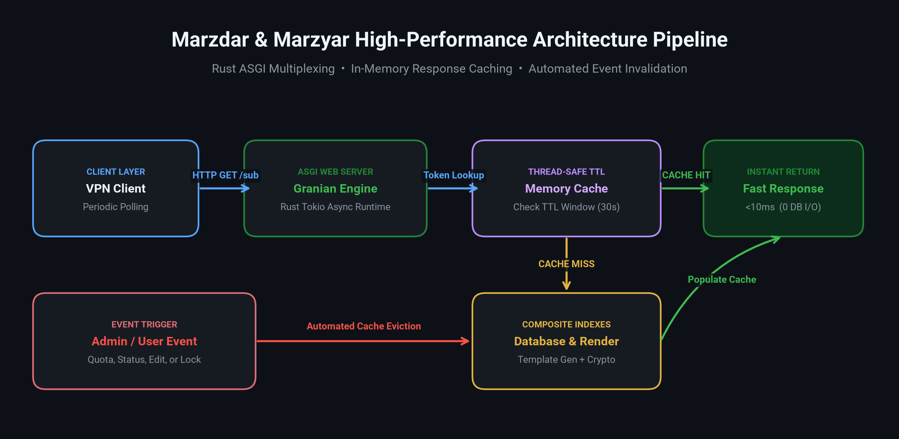
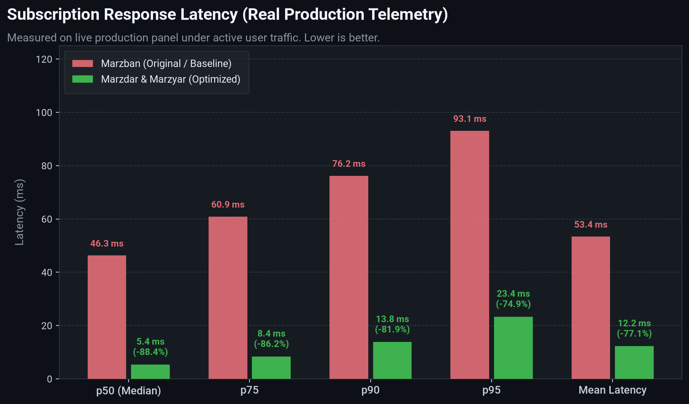
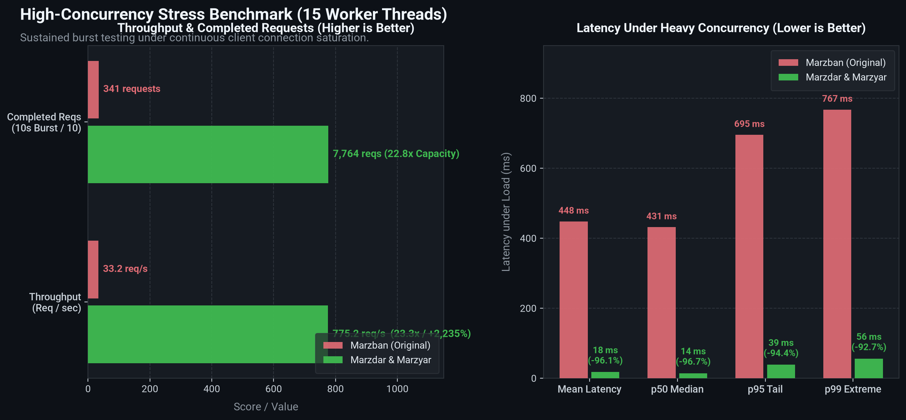

<p align="center">
  <a href="https://github.com/MehrWizard/Marzyar" target="_blank" rel="noopener noreferrer">
    
  </a>
</p>

<h1 align="center">مرزیار (Marzyar)</h1>

<p align="center">
  یک فورک کاملاً سازگار و جایگزین مستقیم برای <a href="https://github.com/gozargah/marzban">مرزبان (Marzban)</a> و <a href="https://github.com/MehrWizard/Marzdar">مرزدار (Marzdar)</a> با پنل کاربری کامل، سهمیه‌بندی پیشرفته نمایندگان، سقف تعداد کاربران، قابلیت اورسل و محدودسازی پروتکل‌ها.
</p>

<p align="center">
  <a href="https://github.com/MehrWizard/Marzyar/actions/workflows/build.yml">
    
  </a>
  <a href="https://hub.docker.com/r/mehrwizard/marzyar" target="_blank">
    
  </a>
  <a href="https://github.com/MehrWizard/Marzyar/stargazers">
    
  </a>
  <a href="./LICENSE">
    
  </a>
  <a href="https://t.me/MehrRoom" target="_blank">
    
  </a>
  <a href="https://x.com/MehrWizard" target="_blank">
    
  </a>
</p>

<p align="center">
  <a href="./README.md">English</a>
  /
  <a href="./README-fa.md">فارسی</a>
  /
  <a href="./README-zh-cn.md">简体中文</a>
  /
  <a href="./README-ru.md">Русский</a>
</p>

<p align="center">
  <a href="https://github.com/MehrWizard/Marzyar" target="_blank" rel="noopener noreferrer">
    
  </a>
</p>

---

## مرزیار چیست؟

**مرزیار** نسخه ارتقایافته و مجهز به سیستم مدیریت نمایندگان (Resellers) از پروژه‌های **مرزدار** و **مرزبان** است.

در حالی که پروژه **مرزدار** بر تکمیل بخش‌های جامانده رابط کاربری تمرکز دارد، **مرزیار** قابلیت‌های مدیریت، سهمیه‌بندی و کنترل دسترسی نمایندگان را به صورت بومی و بدون تغییر جداول اصلی پایگاه داده به سیستم اضافه کرده است:

1. **سقف تعداد حساب‌های کاربری**: تعیین حداکثر تعداد کاربرانی که هر ادمین/نماینده می‌تواند بسازد.
2. **سهمیه حجم و کنترل اورسل (Oversell)**:
   - **محدودیت مصرف یکپارچه**: در *تمامی* حالت‌ها، مجموع ترافیک مصرفی (`∑ active_usage + historical_resets_and_deletions`) هرگز نمی‌تواند از `traffic_limit` نماینده تجاوز کند.
   - **حالت بدون اورسل (سخت‌گیرانه)**: *علاوه بر شرط بالا*، مجموع محدودیت‌های تخصیص‌یافته به کاربران را نیز محدود می‌کند (`∑ user.data_limit ≤ traffic_limit`). نمایندگان نمی‌توانند بیش از ظرفیت تخصیص دهند یا کاربران با ترافیک نامحدود بسازند.
   - **حالت با اورسل**: محدودیت تخصیص را حذف می‌کند. نمایندگان می‌توانند آزادانه سرویس بسازند تا زمانی که مجموع مصرف واقعی به سقف سهمیه برسد.
   - **محاسبه امن و غیرقابل دور زدن**: نمایندگان نمی‌توانند با ریست کردن یا حذف کاربران، سهمیه خود را دور بزنند؛ مصرف گذشته کاربران حذف‌شده یا ریست‌شده در شمارنده مصرف تاریخی نماینده انباشته می‌شود.
3. **وضعیت هوشمند قفل (Locked State Machine)**:
   - با عبور نماینده از سهمیه، کاربران فعال او بدون تغییر در وضعیت دیتابیس به صورت موقت قفل شده و فوراً از اینباندهای Xray قطع می‌شوند.
   - با تمدید یا ریست سهمیه توسط ادمین کل (Sudo)، کاربران قفل‌شده بلافاصله باز شده و به هسته Xray بازمی‌گردند.
4. **اینباندهای مجاز (Allowed Inbounds)**: امکان محدود کردن نماینده به پروتکل‌ها و اینباندهای خاص (مثلاً فقط VMess).
5. **ویجت وضعیت سهمیه در هدر پنل**: نمایش زنده حجم مصرفی، سقف کاربران و کاربران قفل شده برای نماینده.

---

## نصب و راه‌اندازی

برای جابجایی از مرزبان یا مرزدار به مرزیار، کافیست ایمیج داکر را در `docker-compose.yml` تغییر دهید:

```yaml
services:  
  marzban:  
    image: mehrwizard/marzyar:latest
```

سپس دستور زیر را اجرا نمایید:
```bash
marzban update
```

---

## مستندات API

علاوه بر اندپوینت‌های استاندارد مرزبان، مرزیار دارای مجموعه‌ای از اندپوینت‌های اختصاصی REST تحت پیشوند `/api/marzyar` است که امکان مدیریت سهمیه‌های ترافیک، سقف تعداد کاربران، حالت اورسل، اینباندهای مجاز و کاربران قفل‌شده را از طریق کدنویسی و اسکریپت‌ها فراهم می‌کند.

مستندات تعاملی Swagger/OpenAPI نیز در مسیر `/docs` پنل (در صورت فعال بودن متغیر `DOCS=true`) به صورت زنده در دسترس است.

### احراز هویت (Authentication)
تمامی اندپوینت‌های مرزیار نیازمند توکن Bearer معتبر مرزبان هستند. توکن دریافتی را در هدر `Authorization` ارسال کنید:
```http
Authorization: Bearer <access_token>
```
برای دریافت توکن دسترسی:
```bash
curl -X POST "https://your-panel-domain:8000/api/admin/token" \
  -H "Content-Type: application/x-www-form-urlencoded" \
  -d "username=admin&password=yourpassword"
```

---

### فهرست اندپوینت‌ها

| متد | مسیر (Endpoint) | سطح دسترسی | توضیحات |
| :--- | :--- | :--- | :--- |
| `GET` | `/api/marzyar/admins` | فقط Sudo | دریافت تنظیمات، محدودیت‌ها، مصرف سهمیه و وضعیت قفل برای تمام ادمین‌ها |
| `GET` | `/api/marzyar/admin/{admin_identifier}/settings` | فقط Sudo | دریافت تنظیمات و آمار مصرف زنده یک ادمین خاص |
| `PUT` | `/api/marzyar/admin/{admin_identifier}/settings` | فقط Sudo | ویرایش سقف کاربر، سهمیه ترافیک، حالت اورسل و اینباندهای مجاز نماینده |
| `POST` | `/api/marzyar/admin/{admin_identifier}/reset_quota` | فقط Sudo | ریست شمارنده مصرف ترافیک نماینده و باز کردن آنی کاربران قفل‌شده |
| `GET` | `/api/marzyar/my_limits` | تمامی ادمین‌ها | دریافت محدودیت‌ها، سهمیه باقی‌مانده و دسترسی‌های ادمین لاگین‌شده |
| `GET` | `/api/marzyar/locked_users` | تمامی ادمین‌ها | مشاهده لیست کاربران قفل‌شده به همراه علت و زمان قفل شدن |

---

### ۱. دریافت تنظیمات و سهمیه همه ادمین‌ها
- **مسیر**: `GET /api/marzyar/admins`
- **دسترسی**: فقط ادمین کل (Sudo Admin).
- **توضیحات**: فهرستی از وضعیت تمام ادمین‌ها شامل سقف کاربران، سهمیه ترافیک، ترافیک تخصیص‌یافته، ترافیک مصرف‌شده کل و تعداد کاربران قفل‌شده را برمی‌گرداند.

#### نمونه درخواست
```bash
curl -X GET "https://your-panel-domain:8000/api/marzyar/admins" \
  -H "Authorization: Bearer <token>"
```

#### نمونه پاسخ (`200 OK`)
```json
[
  {
    "admin_id": 2,
    "username": "reseller1",
    "is_sudo": false,
    "users_limit": 50,
    "traffic_limit": 107374182400,
    "oversell_allowed": false,
    "allowed_inbounds": ["VLESS TCP REALITY", "VMess TCP"],
    "quota_used_traffic": 15000000000,
    "current_users_count": 12,
    "current_allocated_traffic": 64424509440,
    "current_consumed_traffic": 21474836480,
    "is_quota_exceeded": false,
    "is_user_limit_exceeded": false,
    "is_allocation_limit_reached": false,
    "locked_users_count": 0
  }
]
```

---

### ۲. دریافت تنظیمات یک ادمین خاص
- **مسیر**: `GET /api/marzyar/admin/{admin_identifier}/settings`
- **دسترسی**: فقط ادمین کل (Sudo Admin).
- **پارامترهای مسیر**:
  - `admin_identifier`: شناسه عددی ادمین (مثلاً `2`) یا نام کاربری (مثلاً `reseller1`).

#### نمونه درخواست
```bash
curl -X GET "https://your-panel-domain:8000/api/marzyar/admin/reseller1/settings" \
  -H "Authorization: Bearer <token>"
```

---

### ۳. ویرایش تنظیمات و محدودیت‌های نماینده
- **مسیر**: `PUT /api/marzyar/admin/{admin_identifier}/settings`
- **دسترسی**: فقط ادمین کل (Sudo Admin).
- **بدنه درخواست** (`application/json`):
  | فیلد | نوع | الزامی | توضیحات |
  | :--- | :--- | :--- | :--- |
  | `users_limit` | عدد صحیح \| null | خیر | سقف تعداد کاربران مجاز (`null` برای نامحدود). |
  | `traffic_limit` | عدد صحیح \| null | خیر | سهمیه ترافیک به **بایت** (`null` برای نامحدود). مثال: `107374182400` برای ۱۰۰ گیگابایت. |
  | `oversell_allowed` | بولی (boolean) | خیر | `false` = حالت بدون اورسل (سخت‌گیرانه)؛ `true` = حالت با اورسل. |
  | `allowed_inbounds` | آرایه‌ای از رشته‌ها \| null | خیر | فهرست تگ‌های اینباندهای مجاز (`null` برای دسترسی به همه). |

> **نکته**: به‌روزرسانی تنظیمات فوراً وضعیت سهمیه‌ها را بازبینی می‌کند: در صورت افزایش محدودیت، کاربران قفل‌شده بلافاصله باز می‌شوند؛ در صورت تغییر اینباندها، کاربران فوراً در Xray همگام‌سازی می‌گردند.

#### نمونه درخواست
```bash
curl -X PUT "https://your-panel-domain:8000/api/marzyar/admin/reseller1/settings" \
  -H "Authorization: Bearer <token>" \
  -H "Content-Type: application/json" \
  -d '{
    "users_limit": 100,
    "traffic_limit": 214748364800,
    "oversell_allowed": true,
    "allowed_inbounds": ["VLESS TCP REALITY"]
  }'
```

---

### ۴. ریست کردن شمارنده مصرف نماینده
- **مسیر**: `POST /api/marzyar/admin/{admin_identifier}/reset_quota`
- **دسترسی**: فقط ادمین کل (Sudo Admin).
- **توضیحات**: شمارنده مصرف ترافیک انباشته‌شده نماینده را صفر می‌کند و کلیه کاربران قفل‌شده او را بلافاصله در Xray آزاد و فعال می‌نماید.

#### نمونه درخواست
```bash
curl -X POST "https://your-panel-domain:8000/api/marzyar/admin/reseller1/reset_quota" \
  -H "Authorization: Bearer <token>"
```

---

### ۵. دریافت محدودیت‌های ادمین جاری (سرویس خودکار)
- **مسیر**: `GET /api/marzyar/my_limits`
- **دسترسی**: کلیه ادمین‌ها (سودو یا نماینده).
- **توضیحات**: محدودیت‌ها، سهمیه مصرفی، سهمیه باقی‌مانده و دسترسی‌های ادمینی که توکن به نام اوست را برمی‌گرداند. بسیار مناسب برای توسعه ربات‌ها و اپلیکیشن‌های جانبی نمایندگان.

#### نمونه درخواست
```bash
curl -X GET "https://your-panel-domain:8000/api/marzyar/my_limits" \
  -H "Authorization: Bearer <token>"
```

#### نمونه پاسخ (`200 OK`)
```json
{
  "username": "reseller1",
  "is_sudo": false,
  "users_limit": 50,
  "traffic_limit": 107374182400,
  "oversell_allowed": false,
  "allowed_inbounds": ["VLESS TCP REALITY"],
  "current_users_count": 12,
  "current_allocated_traffic": 64424509440,
  "current_consumed_traffic": 21474836480,
  "is_quota_exceeded": false,
  "is_user_limit_exceeded": false,
  "is_allocation_limit_reached": false,
  "locked_users_count": 0
}
```

---

### ۶. مشاهده لیست کاربران قفل‌شده
- **مسیر**: `GET /api/marzyar/locked_users`
- **دسترسی**: کلیه ادمین‌ها.
  - **ادمین کل (Sudo)**: مشاهده تمام کاربران قفل‌شده در کل سیستم.
  - **ادمین نماینده (Reseller)**: مشاهده فقط کاربران قفل‌شده تحت مالکیت خودش.

#### نمونه درخواست
```bash
curl -X GET "https://your-panel-domain:8000/api/marzyar/locked_users" \
  -H "Authorization: Bearer <token>"
```

#### نمونه پاسخ (`200 OK`)
```json
[
  {
    "user_id": 42,
    "username": "client_alice",
    "admin_username": "reseller1",
    "locked_at": "2026-10-20T14:30:00",
    "lock_reason": "Admin quota exceeded"
  }
]
```

---

## مقایسه قابلیت‌ها

| بخش | مرزبان (پروژه اصلی) | مرزدار | مرزیار |
| :--- | :--- | :--- | :--- |
| **سازگاری و جابجایی** | استاندارد | ۱۰۰٪ سازگار | ۱۰۰٪ سازگار (بدون دستکاری جداول اصلی) |
| **رابط کاربری وب** | ناقص | ✅ کامل | ✅ کامل |
| **موتور سرور وب (ASGI)** | Uvicorn (پایتون) | ⚡ **Granian (مبتنی بر Rust و Tokio)** | ⚡ **Granian (مبتنی بر Rust و Tokio)** |
| **کش اشتراک‌ها (Response Cache)** | ❌ ندارد (محاسبه مجدد در هر درخواست) | ⚡ **کش حافظه‌ای درون‌برنامه‌ای با ابطال خودکار** | ⚡ **کش حافظه‌ای درون‌برنامه‌ای با ابطال خودکار** |
| **ایندکس‌های پایگاه‌داده** | استاندارد | ⚡ **ایندکس‌های ترکیبی بهینه‌شده برای ترافیک بالا** | ⚡ **ایندکس‌های ترکیبی بهینه‌شده برای ترافیک بالا** |
| **سقف تعداد کاربران نماینده** | ❌ ندارد | ❌ ندارد | ✅ دارد (تحت پنل وب) |
| **سهمیه ترافیک و اورسل** | ❌ ندارد | ❌ ندارد | ✅ دارد (با کنترل دقیق) |
| **قطع خودکار در اتمام سهمیه** | ❌ ندارد | ❌ ندارد | ✅ دارد (جدا شدن آنی از Xray) |
| **محدودسازی اینباندهای نماینده** | ❌ ندارد | ❌ ندارد | ✅ دارد |
| **قابلیت بازگشت به مرزبان** | - | ✅ ایمن | ✅ ۱۰۰٪ ایمن (بدون مایگریشن‌های مخرب) |

---

## بهبود عملکرد و بنچمارک‌های زنده عملیاتی (Real-World Telemetry)

پروژه‌های **مرزدار** و **مرزیار** مجهز به بهینه‌سازی‌های زیرساختی عمیقی هستند که برای پنل‌های عملیاتی پرترافیک و صدها اتصال همزمان کلاینت‌ها طراحی شده است:

1. **موتور سرور وب مبتنی بر راست ([Granian](https://github.com/emmett-framework/granian))**: جایگزینی سرور پایتونی Uvicorn با موتور پرسرعت Granian که با استفاده از موتور ناهمگام Tokio و اتصالات C/PyO3 توان پاسخگویی بسیار بالاتری را با مصرف کمتر پردازنده ارائه می‌دهد.
2. **کش حافظه‌ای پاسخ لینک‌های اشتراک (Subscription Response Cache)**: ذخیره‌سازی پاسخ‌های تولیدشده لینک اشتراک در حافظه رم با طول عمر معین (۳۰ ثانیه) و ابطال خودکار آنی به محض تغییر وضعیت، حجم یا تنظیمات کاربر. این بهینه‌سازی محاسبات سنگین قالب‌ها، رمزنگاری توکن‌ها و کوئری‌های تکراری دیتابیس را در درخواست‌های مکرر کلاینت‌ها حذف می‌کند.
3. **ایندکس‌گذاری ترکیبی و استراتژیک دیتابیس**: افزودن ایندکس‌های مرکب کلیدی روی جداول پرترافیک (`users(online_at)`، `users(created_at)`، `node_user_usages(node_id, created_at)` و `node_usages(node_id, created_at)`) برای حذف اسکن‌های خطی سنگین دیتابیس در زمان آمارگیری نودها.
4. **تاب‌آوری چرخه اتصال نودها و آمارگیری**: ایزوله‌سازی چرخه‌های همگام‌سازی نودها، اعمال مهلت زمانی (Timeout) بر فراخوانی‌های gRPC و مدیریت خطای بهینه به طوری که اختلال در ارتباط با نودها باعث کندی API پنل نشود.

<p align="center">
  
</p>

### شاخص‌های کلیدی بهبود عملکرد:
- ⚡ **۸.۶ برابر پاسخ‌دهی سریع‌تر در میانه**: کاهش میانه (p50) تأخیر پاسخ اشتراک از ۴۶.۲۷ به ۵.۳۷ میلی‌ثانیه (**۸۸.۴٪ سریع‌تر**).
- 🚀 **۲,۲۳۵٪+ توان سرویس‌دهی همزمان بیشتر**: ثبت ۷۷۵.۲ درخواست در ثانیه در برابر ۳۳.۲ درخواست بر ثانیه در تست بار مداوم ۱۵ ورکر همزمان (**۲۳.۳ برابر ظرفیت پردازش**).
- ⚡ **۹۶.۱٪ کاهش تأخیر زیر بار سنگین همزمان**: کاهش میانگین تأخیر درخواست‌ها در تست بار شدید از ۴۴۷.۶۶ به ۱۷.۵۳ میلی‌ثانیه (**۲۵.۵ برابر سریع‌تر**).
- 🗄️ **۳۱.۷٪ کاهش فشار بر دیتابیس MySQL**: کاهش جهش مصرف دیتابیس از ۵۳.۶۲٪ به ۳۶.۶۴٪ به کمک کش هوشمند رم و ایندکس‌های مرکب حتی زیر بار ۳۶,۰۰۰ کوئری شبیه‌سازی‌شده.
- 📦 **۲۲.۸ برابر ظرفیت سرویس‌دهی بیشتر**: ثبت ۷,۷۶۴ درخواست موفق در بازه ۱۰ ثانیه‌ای در مقایسه با ۳۴۱ درخواست در مرزبان پایه.
- 🛡️ **۲۵.۶٪ مهار اسپایک‌های کندی**: کاهش شدیدترین جهش تأخیر از ۶۰۴.۳۶ به ۴۴۹.۶۳ میلی‌ثانیه در بار پیوسته.

---

### گزارش‌های تفکیکی بنچمارک

<details open>
<summary><b>۱. تأخیر زمانی پاسخ‌دهی اندپوینت اشتراک (۸.۶ برابر سریع‌تر در میانه)</b></summary>

<p align="center">
  
</p>

اندازه‌گیری‌شده از طریق مانیتورینگ زنده عملیاتی تحت ترافیک واقعی کلاینت‌ها و اعمال بار پیوسته شبیه‌سازی‌شده:

| صدک تأخیر (Percentile) | مرزبان اصلی (پیش‌فرض / Baseline) | مرزدار و مرزیار (بهینه‌سازی‌شده) | میزان بهبود |
| :--- | :--- | :--- | :--- |
| **میانه (p50 Median)** | **۴۶.۲۷ میلی‌ثانیه** | **۵.۳۷ میلی‌ثانیه** | **۸۸.۴٪- سریع‌تر (۸.۶ برابر)** |
| **صدک ۷۵ (p75)** | **۶۰.۸۹ میلی‌ثانیه** | **۸.۳۹ میلی‌ثانیه** | **۸۶.۲٪- سریع‌تر (۷.۳ برابر)** |
| **صدک ۹۰ (p90)** | **۷۶.۲۱ میلی‌ثانیه** | **۱۳.۸۱ میلی‌ثانیه** | **۸۱.۹٪- سریع‌تر (۵.۵ برابر)** |
| **صدک ۹۵ (p95)** | **۹۳.۰۸ میلی‌ثانیه** | **۲۳.۳۵ میلی‌ثانیه** | **۷۴.۹٪- سریع‌تر (۴.۰ برابر)** |
| **میانگین کل (Mean)** | **۵۳.۳۸ میلی‌ثانیه** | **۱۲.۲۵ میلی‌ثانیه** | **۷۷.۱٪- سریع‌تر (۴.۴ برابر)** |

```
نمودار تأخیر پاسخ‌دهی اشتراک‌ها (میلی‌ثانیه - کمتر بهتر است):

میانه (p50):
  مرزبان اصلی:        ████████████████████████ 46.27 ms
  مرزدار و مرزیار:    ███ 5.37 ms (-88.4%)

صدک ۹۵ (p95):
  مرزبان اصلی:        ██████████████████████████████████████████████ 93.08 ms
  مرزدار و مرزیار:    ████████████ 23.35 ms (-74.9%)

میانگین (Mean):
  مرزبان اصلی:        ███████████████████████████ 53.38 ms
  مرزدار و مرزیار:    ██████ 12.25 ms (-77.1%)
```
</details>

<details>
<summary><b>۲. پایداری منابع سخت‌افزاری و پردازنده در ترافیک زنده</b></summary>

<p align="center">
  
</p>

آمارهای ثبت‌شده پیوسته تحت ترافیک واقعی سرور عملیاتی:

| شاخص اندازه‌گیری | مرزبان اصلی (پیش‌فرض / Baseline) | مرزدار و مرزیار (بهینه‌سازی‌شده) | نتیجه و تأثیر |
| :--- | :--- | :--- | :--- |
| **حداکثر جهش پردازنده دیتابیس MySQL** | ۵۳.۶۲٪ | **۳۶.۶۴٪** | **۳۱.۷٪ کاهش فشار بر دیتابیس** |
| **حداکثر اسپایک تأخیر (Max Spike)** | ۶۰۴.۳۶ میلی‌ثانیه | **۴۴۹.۶۳ میلی‌ثانیه** | **۲۵.۶٪ کاهش اسپایک‌های سنگین** |
| **مصرف حافظه رم (RAM)** | ~۱۲۵ مگابایت | ~۱۷۵ مگابایت | کنترل‌شده با مدیریت محدود حافظه کش |
</details>

<details>
<summary><b>۳. تست بار و بنچمارک فشار همزمان (۲,۲۳۵٪+ ظرفیت خروجی بیشتر)</b></summary>

<p align="center">
  
</p>

تست بار سنگین همزمان جهت سنجش ظرفیت تولید اشتراک تحت فشار متوالی (۱۵ ورکر همزمان، به مدت ۱۰ ثانیه کامل):

| شاخص بنچمارک | مرزبان اصلی (Uvicorn / بدون کش) | مرزدار و مرزیار (Granian + کش + ایندکس‌ها) | تأثیر و نتیجه |
| :--- | :--- | :--- | :--- |
| **توان خروجی (درخواست بر ثانیه)** | **۳۳.۲ req/s** | **۷۷۵.۲ req/s** | **۲,۲۳۵٪+ توان پاسخگویی بیشتر (۲۳.۳ برابر)** 🚀 |
| **میانگین تأخیر زیر بار** | **۴۴۷.۶۶ میلی‌ثانیه** | **۱۷.۵۳ میلی‌ثانیه** | **۹۶.۱٪- کاهش تأخیر (۲۵.۵ برابر سریع‌تر)** |
| **میانه تأخیر زیر بار (p50)** | **۴۳۱.۴۷ میلی‌ثانیه** | **۱۴.۳۴ میلی‌ثانیه** | **۹۶.۷٪- کاهش تأخیر (۳۰.۱ برابر سریع‌تر)** |
| **صدک ۹۵ زیر بار (p95)** | **۶۹۵.۲۲ میلی‌ثانیه** | **۳۸.۶۲ میلی‌ثانیه** | **۹۴.۴٪- کاهش تأخیر (۱۸.۰ برابر سریع‌تر)** |
| **صدک ۹۹ زیر بار (p99)** | **۷۶۷.۳۱ میلی‌ثانیه** | **۵۵.۸۵ میلی‌ثانیه** | **۹۲.۷٪- کاهش تأخیر (۱۳.۷ برابر سریع‌تر)** |
| **تعداد کل درخواست‌های پاسخ‌داده‌شده** | ۳۴۱ درخواست | **۷,۷۶۴ درخواست** | **۲۲.۸ برابر ظرفیت سرویس‌دهی بیشتر** |

```
توان سرویس‌دهی همزمان (درخواست در ثانیه - بیشتر بهتر است):
  مرزبان اصلی:        █ 33.2 req/s
  مرزدار و مرزیار:    ███████████████████████ 775.2 req/s (+2,235% / 23.3x)

تأخیر زیر بار ترافیکی (میلی‌ثانیه - کمتر بهتر است):
  مرزبان اصلی:        ████████████████████████ 447.66 ms
  مرزدار و مرزیار:    █ 17.53 ms (-96.1% / 25.5x faster)
```
</details>

<details>
<summary><b>۴. داشبورد کامل و یکپارچه بنچمارک‌ها (گزارش جامع)</b></summary>

<p align="center">
  
</p>
</details>

---

## حمایت مالی (Donation)

اگر مرزیار برای شما مفید واقع شده و مایل به حمایت از توسعه آن هستید:

- [حمایت مالی از طریق درگاه پرداخت مهرنت](https://gateway.mehrnet.com/product/1DE5C11019E2)

---

## لایسنس

مرزیار تحت لایسنس [GNU Affero General Public License v3.0 (AGPL-3.0)](./LICENSE) منتشر شده است.
